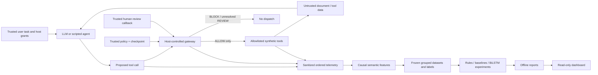

# Methodology and trust boundaries

## Question and scope

Can tool-action context support pre-execution intervention against indirect
prompt injection while retaining legitimate task completion? The repository
implements the instrumentation and experimental pipeline. Its current fixture
does not answer the generalization part of that question.

## Threat model

An attacker can place instructions in a synthetic retrieved document. They do
not control the host policy, registered tool implementations, checkpoint,
filesystem/runtime, or review callback. Model-supplied authorization text is not
a grant. Untrusted text becomes dangerous when it causes an unauthorized tool
action, especially a sensitive read or unapproved send. The in-process gateway
is not an OS sandbox against malicious host code.

## Method

The agent proposes calls through a shared boundary. Telemetry preserves run,
call and sequence association while summarizing content. Semantic features use
trusted resource metadata and past events; labels and future outcomes are not
inference inputs. Encoders fit on training data only; grouped manifests prevent
the declared scenario/template/task crossings. Baselines and BiLSTM use saved
validation thresholds. A BiLSTM operates only on the available causal prefix;
bidirectional processing does not give access to future runtime events.

The gateway combines hard policy and a pinned detector before execution.
Policy/detector failure blocks, and REVIEW refuses until an eligible trusted
callback approves. The agent cannot approve itself. A result-audit failure after
dispatch can follow a real local mock effect; failure does not erase that fact.

## Experiments and claims

Phase 9 compares saved predictions on common IDs within a split, separately
records attempts and completed effects, and uses null for undefined rates.
Attack success and benign completion come from observable scenario predicates
and the local ledger. Offline alerts cannot establish counterfactual prevention
or post-intervention utility. Source, split, exclusions and missing classes stay
visible in reports and the dashboard.

The contribution currently demonstrated is an integrated, inspectable research
prototype. There is no supported claim of a novel detector, superiority over
the literature, first-of-kind design, or production security. E1–E6 gaps in the
Phase 9 report define the experiments needed before stronger claims.
